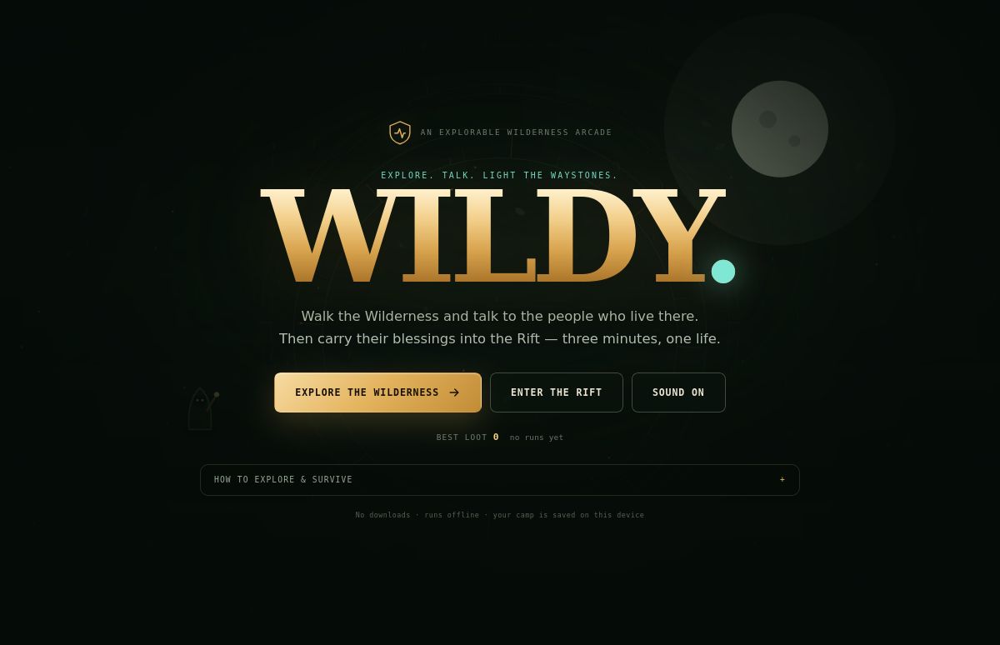
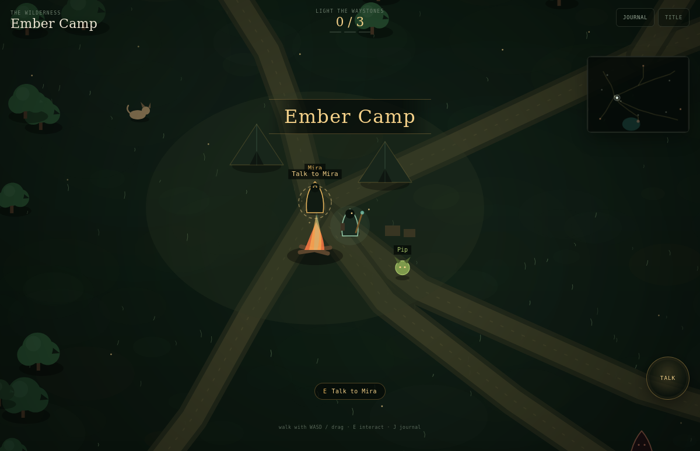
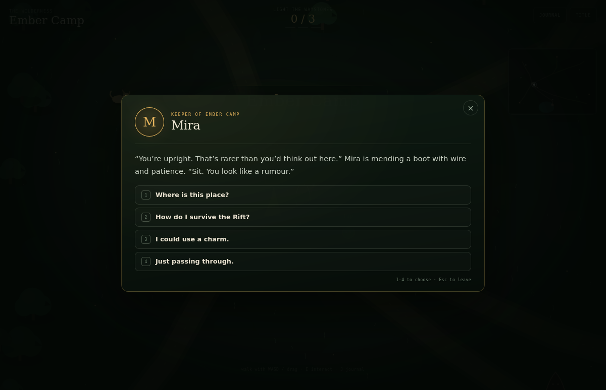
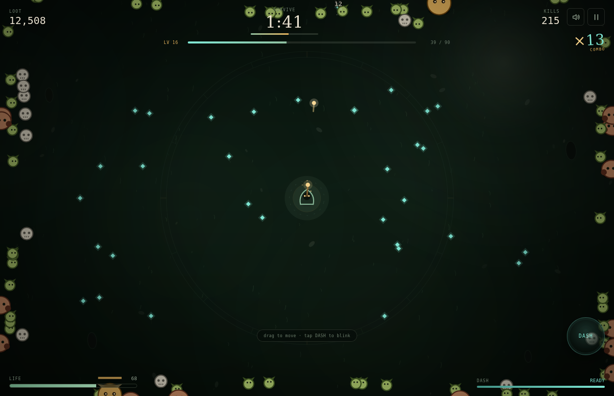
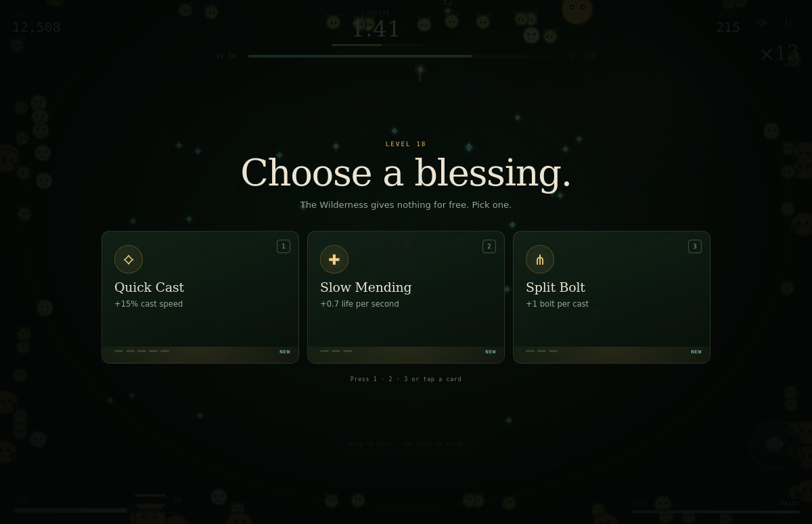

# WILDY

[](https://github.com/joshualparris/RunescapeFedoraCrashDoctor/actions/workflows/test.yml)
[](https://joshualparris.github.io/RunescapeFedoraCrashDoctor/)
[](LICENSE)



**Explore. Talk. Light the waystones. Then survive three minutes.**

WILDY is a tiny browser game with two halves. In **explore mode** you walk a
hand-drawn Wilderness, talk to the people who live there, find three waystones
and fill a field journal. In **the Rift**, those camp blessings feed a
three-minute survivor-like: auto-cast rune bolts, collect shards, choose a
blessing each level and dash through the horde.

**[Play WILDY](https://joshualparris.github.io/RunescapeFedoraCrashDoctor/)** ·
[Explore directly](https://joshualparris.github.io/RunescapeFedoraCrashDoctor/?explore) ·
[Rift directly](https://joshualparris.github.io/RunescapeFedoraCrashDoctor/?play) ·
[Design notes](DESIGN.md)

No install, no account, no backend. It runs offline after the first load and can
be added to an Android or iOS home screen as a PWA.

| Explore the Wilderness | Talk to the people |
| --- | --- |
|  |  |

| Mid-run in the Rift | Choose a blessing |
| --- | --- |
|  |  |

---

## Explore mode

The Wilderness is one continuous map — no loading screens, no combat. Walk from
Ember Camp into the woods, the rune circle, the ruins or down to the Rift.

- **Seven characters** with branching conversations: Mira the Keeper, Pip the
  imp, Old Bran, Sable the scavenger, the Echo, the Warden, and a very good hound
  called Moss.
- **Three waystones** hold the memories that keep the Rift shut. Touch all three
  and the Warden will open it.
- **Three buried caches** add loot to your next run.
- **Four camp blessings** carry into the Rift:
  - Keeper’s Charm — +20 max life
  - Lucky Pebble — +1 blessing reroll
  - Bran’s Ember — +15% bolt damage
  - Scavenger’s Stride — +8% movement speed
- **A field journal** (J) records every waystone, cache and scrap of lore.
- **A small hound quest.** Bran has lost Moss. The woods are west.

| Explore | Keyboard | Touch |
| --- | --- | --- |
| Walk | `WASD` / arrows | drag anywhere |
| Talk / touch / open | `E` | the **TALK / TOUCH / OPEN** button |
| Journal | `J` | Journal button |
| Choose a reply | `1`–`6` | tap a choice |
| Leave a conversation | `Esc` | close button |

The Rift stays sealed until all three waystones are lit. You can still talk to
the Warden early; he will tell you where to look.

## The Rift

| Action | Keyboard | Touch |
| --- | --- | --- |
| Move | `WASD` / arrows | drag anywhere |
| Dash | `Space` | the **DASH** rune button |
| Pick a blessing | `1` `2` `3` | tap a card |
| Reroll a blessing | Reroll button (if earned) | tap Reroll |
| Pause | `P` / `Esc` | pause button |
| Mute | `M` | speaker button |

- **Auto-cast:** the staff targets the nearest enemy. You never aim.
- **Shards:** every kill drops one. Walk over them (or build the magnet).
- **Blessings:** eleven upgrades, three offered per level. Stack them; the build
  is the run.
- **Elites:** gold, chunky, worth a lot. They arrive on the half-minute.
- **Boss:** 1,900 HP of Greater Demon at 2:30. Kill it early for the greedy win.
- **Survive 3:00** to win the patient way.

### On a phone

Open the live URL in Chrome (Android) or Safari (iOS), then **Add to Home
screen**. The service worker caches the whole game; after the first visit it
works with no network. Portrait and landscape both work, and the controls are
thumb-sized.

---

## The loop

```
 explore → talk → light three waystones → Warden opens the Rift
    ↑                                              │
    │                                              ▼
 return to camp ← die / survive ← three-minute run
```

A run is three minutes. The Wilderness is safe; the Rift is not. Camp blessings
and buried loot persist between runs, so exploring is never wasted. The journal
and journey are saved locally; the only thing the game remembers about combat is
your best loot, best survival time and how many runs you have taken into the dark.

### Why it is fun

The short version, with the longer argument and sources in [DESIGN.md](DESIGN.md):

- **Discovery** — the map withholds context instead of dumping a quest log. NPCs
  hint at places; the journal fills in as you find them.
- **Autonomy** — conversation choices decide which blessings you can earn, and
  every Rift level is a real fork: damage, speed, split bolts, pierce, crit,
  life, magnet, regen, armour, dash.
- **Competence** — kills, damage numbers, level-ups and a visibly faster clear
  make improvement legible. Auto-cast removes aiming friction; dash is the
  skill ceiling.
- **Flow & pacing** — a calm, readable exploration mode makes the Rift’s noise
  hit harder. The Rift’s difficulty rises smoothly instead of spiking without
  warning.
- **Juice** — hit-stop, screen shake, particles, damage text, synth SFX and
  flashes, reserved for the moments that deserve them so the screen stays
  readable.
- **One more run** — three-minute sessions, a prominent retry button and a score
  that is worth beating.

---

## Under the hood

The game has **zero runtime dependencies**. Everything is drawn with the Canvas
2D API and every sound is synthesised with the Web Audio API.

```
index.html                 title, explore HUD, dialogue, journal, Rift HUD
src/styles.css             field-instrument UI
src/main.js                state machine, input, screens, persistence
src/engine.js              deterministic Rift simulation (no DOM, no canvas)
src/render.js              Rift canvas renderer
src/explore.js             exploration simulation: movement, collision, prompts
src/render-explore.js      Wilderness renderer + minimap
src/npcs.js                NPCs, dialogue trees, waystones, caches, boons, map
src/audio.js               tiny oscillator sound kit
test/engine.test.mjs       14 Rift simulation/balance tests
test/explore.test.mjs      6 exploration/data-integrity tests
test/smoke.test.mjs        full Rift page playthrough in jsdom
test/explore-smoke.test.mjs full explore → talk → boon → Rift playthrough
assets/                    PWA icons, favicon
sw.js                      offline cache
.github/workflows/         tests + GitHub Pages deploy
```

The simulations are separate from rendering on purpose: both can be stepped
headlessly at 60 Hz, which is how movement/collision, the spawn curve, boss
timing, dialogue links and upgrade caps are tested. 22 tests run in CI.

### Local development

```bash
npm install          # dev dependency: jsdom, for the DOM smoke tests
npm start            # http://localhost:8137
npm test             # simulation + DOM tests
npm run check        # syntax checks
```

`npm start` uses Python's static server. Any static file server works; ES modules
need HTTP, not `file://`.

### Deploying

Push to `main`. `.github/workflows/pages.yml` stages the static files into
`dist/` and deploys them to GitHub Pages. No build step, no secrets, no server.

---

## Research and design

[DESIGN.md](DESIGN.md) contains the working notes behind both halves:

- MDA: mechanics → dynamics → aesthetics, and why "fun" is emergent.
- Flow: clear goals, immediate feedback, challenge–skill balance.
- Self-determination theory: competence and autonomy.
- Curiosity as an information gap: why the journal, hints and locked Rift work.
- Game feel / juice and its limits.
- The survivor-like reference point.
- The actual numbers: spawn curve, XP curve, scaling, boss timing.
- A playtest checklist and the questions still open.

Sources include the MDA paper, CHI 2024 game-feel research, the *Juice It or Lose
It* talk, curiosity research, and Ars Technica's write-up of *Vampire Survivors*
— all linked in [DESIGN.md](DESIGN.md).

---

## Credits and scope

- Code, vector art and sound synthesis are original for this project.
- RuneScape is a trademark of Jagex Ltd. WILDY is an independent,
  RuneScape-inspired game. It is not affiliated with or endorsed by Jagex, and it
  contains no Jagex assets, accounts, or game data.
- The repository name is a leftover from the first prototype. The finished thing
  is WILDY.
- MIT licensed. See [LICENSE](LICENSE).
